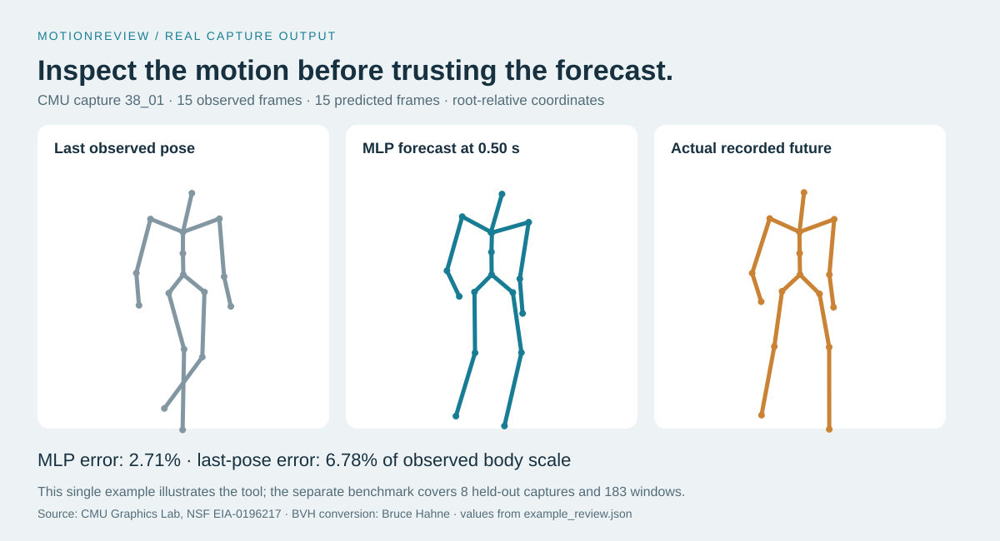
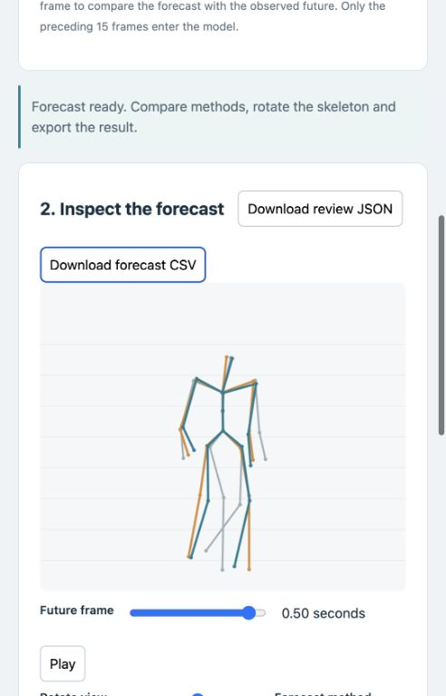

# MotionReview | Human Pose Forecasting

**Bring a recorded human pose sequence, forecast the next half-second, and inspect the prediction against simple baselines.**

MotionReview is a local review tool for motion-data researchers and developers testing animation or human-motion models. Upload a compatible BVH or JSON recording, choose where the forecast starts, rotate the skeleton view, and export predicted joint coordinates. When the recording contains the future, the tool measures error; when it does not, it leaves that score unavailable.



## Run the tool

Python 3.11 or later:

```bash
python -m venv .venv
source .venv/bin/activate
pip install -r requirements.txt
python -m motionreview.app
```

Open **http://127.0.0.1:8782**. The trained checkpoint and a real held-out example are included, so downloading the training dataset is not required to try the app. Uploaded recordings remain in memory on this local machine. No model files or executable code are accepted as uploads.

1. Choose your `.bvh` or `.json` recording, or load the real CMU example.
2. Select a forecast cutoff in the resampled 30 Hz recording. Leaving it blank forecasts after the last frame.
3. Compare the trained model, last-pose baseline and constant-velocity baseline. Rotate the projected 3D skeleton and scrub or play its 15 future frames.
4. Check the observed error and bone-length distortion. Only reference future frames already present in the input contribute to the displayed error.
5. Download JSON with the review, history, predictions and available reference future, or CSV with all predicted joint coordinates.

## Bring your own recording

- BVH must use the MotionBuilder joint names listed in `motionreview/pose.py`. Forward kinematics respects the declared rotation order. Finger/thumb joints are not used.
- JSON requires `fps`, `joint_names`, and `positions` shaped `[frames,17,3]`. The app's downloadable format example is a real CMU recording and shows the exact joint order.
- Coordinate convention is **Y up**, matching CMU's converted skeleton. Preserve handedness and orientation; arbitrary axis conventions are not automatically retargeted. Consistent length units are accepted because only observed bone lengths define the scale.
- Input: 15–20,000 frames, 15–240 Hz, at most 20 MiB. The sequence is linearly resampled to 30 Hz. At least 15 resampled frames are required.
- The output is **root-relative pose**, not global travel. The last 15 observed frames determine the forecast. The MLP root is explicitly anchored at zero; evaluation excludes the root.
- A BVH can contain an added reference pose. The training pipeline removes the conversion's known first T-pose. For user uploads, remove a non-motion reference frame yourself if it falls in the forecast input window.

This is a recording-based workflow, not pose estimation from a video or webcam. A compatible input schema does not guarantee that the locomotion-trained model generalises to a new motion type or capture system. There is no saved session: export results before closing the page.

## Real dataset and fixed evaluation

The source is the [CMU Graphics Lab Motion Capture Database](https://mocap.cs.cmu.edu/), recorded with optical motion capture. We use Bruce Hahne's MotionBuilder-friendly BVH conversion through the [una-dinosauria mirror](https://github.com/una-dinosauria/cmu-mocap), pinned to commit `09a07f54f3bbb58797325f009282d0b2048a2871`. [The conversion documentation](https://github.com/una-dinosauria/cmu-mocap/blob/master/READMEFIRST.txt) identifies its added first T-pose, which is removed from benchmark captures.

The 32-capture pilot uses fixed session IDs:

| Partition | Session IDs | Captures | Forecast windows |
|---|---|---:|---:|
| Train | 2, 7, 8, 9, 16 | 20 | 320 |
| Validation | 35 | 4 | 12 |
| Test | 38, 39 | 8 | 183 |

Selection was fixed before training: the exact trials, source URLs and SHA-256 hashes are in `artifacts/data_manifest.json`. Sessions are disjoint, but CMU warns that the same person can appear under different subject numbers; **identity-disjoint evaluation is not established**. Locomotion dominates this bounded subset, which also includes a jump/balance trial. This is not a full CMU benchmark.

A compact PyTorch residual MLP maps 15 observed 17-joint frames to 15 future frames. It is trained for 35 epochs with Adam, seed 41, and training-window stride 3. Validation/test stride 15 gives nonoverlapping future windows, although nearby observed windows are correlated. Each window uses only observed bone lengths to normalise both history and target. No future target values define model inputs or scale.

Checkpoint selection minimises **pooled validation-window** joint error (best epoch 34). After that checkpoint is fixed, the recommended method is selected by **validation sequence-mean** error across MLP, persistence and constant velocity. Test results do not select epochs, hyperparameters, methods or trial IDs. The root is excluded from reported joint errors, so the metric averages the other 16 joints over the 15 prediction steps.

| Method | Validation sequence-mean error | Test sequence-mean error |
|---|---:|---:|
| Trained residual MLP | 3.32% | 3.29% |
| Last observed pose | 5.60% | 7.17% |
| Constant velocity over last 5 frames | 13.32% | 9.63% |

Units are **percent of observed body scale**, not millimetres. Body scale is the sum of observed left-leg and central-spine segment lengths, including the selected connector edges. Each capture contributes equally to the aggregate despite unequal duration. Full per-capture values, training trace and window counts are retained in `artifacts/`. The long turning capture has much higher error than straight walking; do not read the aggregate as reliable performance on all human motion.

The model is not kinematically constrained. The displayed example has a maximum noncollapsed bone-length change of about **23.9%** relative to its final observed pose. Collapsed connector edges shorter than 0.5% of body scale are excluded from this diagnostic. It is an inspection aid, not an anatomically valid motion generator, force estimator, collision guarantee, clinical tool or physical robot controller.

## Reproduce and test

```bash
python scripts/download_data.py
python scripts/train.py
python scripts/render_result.py
python -m unittest discover -s tests -v
```

Only the 32 named captures are downloaded, not a crawl of CMU's site. The committed source manifest rejects mismatched cached or downloaded bytes. Raw BVH files are excluded from Git. The tests cover analytic BVH forward kinematics, schema validation, normalisation, future-information isolation, session separation, exports, tamper detection and an actual HTTP upload of a separately transformed user recording.

## Data terms and acknowledgement

CMU permits use in research and inclusion in products, but prohibits directly reselling the dataset, including converted forms. Consult the source site's current terms. The derived example is included to demonstrate the tool and retains its original URL and source hash. Bruce Hahne provided the BVH conversion; the mirror makes the same captures accessible over HTTPS.

The data used in this project was obtained from mocap.cs.cmu.edu. The database was created with funding from NSF EIA-0196217.

## Actual uploaded-file review



This browser check used a rescaled and translated copy of a real capture to verify the user-upload workflow. It is a functional check, not an additional benchmark capture.
